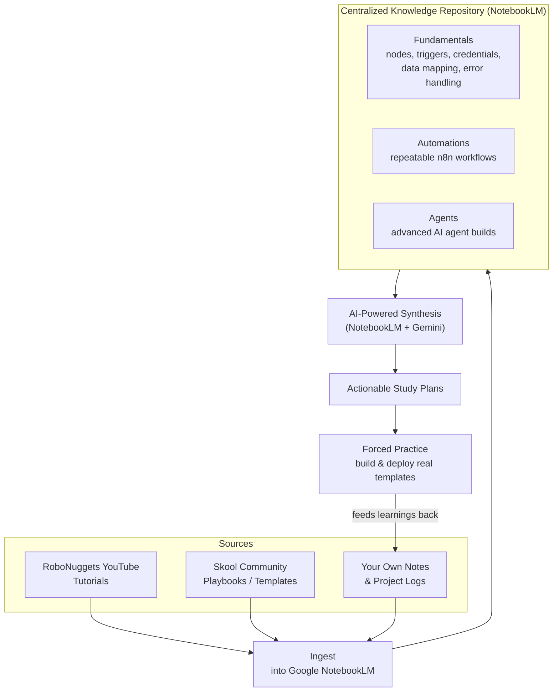

# RoboNuggets "Second Brain" System

**Flow:** Raw content (YouTube tutorials, Skool playbooks, your own notes) → ingested into a single NotebookLM notebook → organized into three categories (Fundamentals, Automations, Agents) → synthesized by AI into study plans → applied through forced practice, which feeds new learnings back into the loop.
